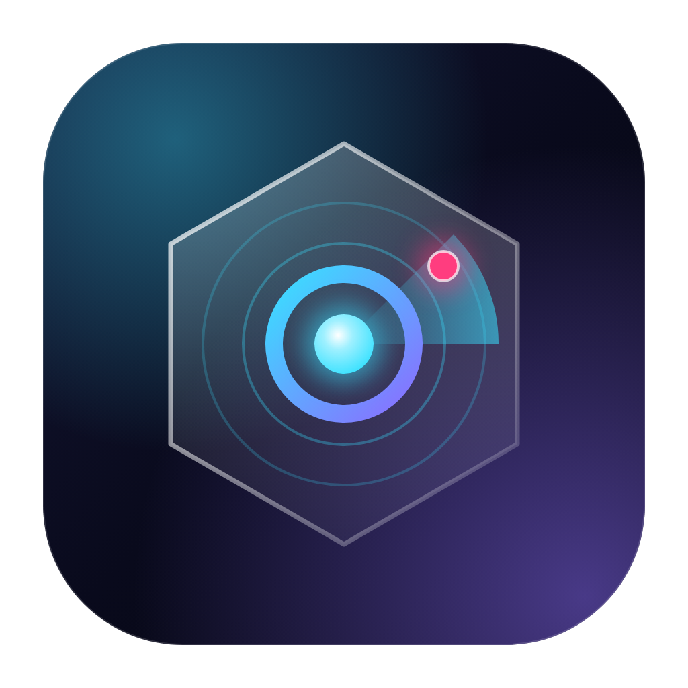
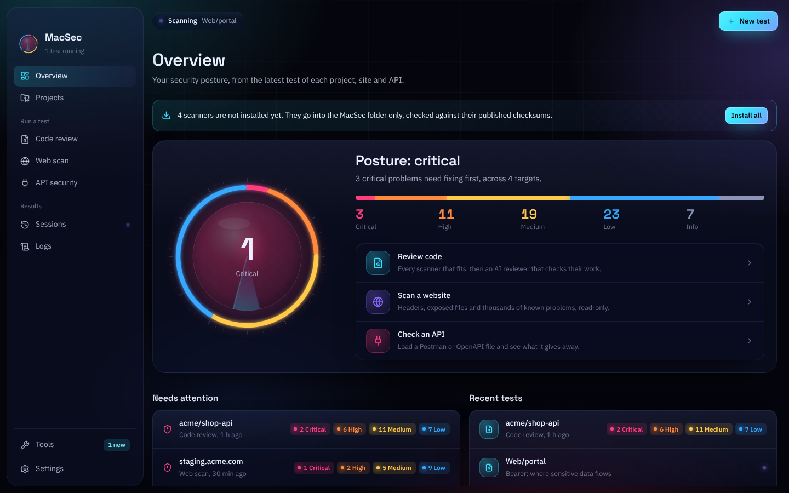
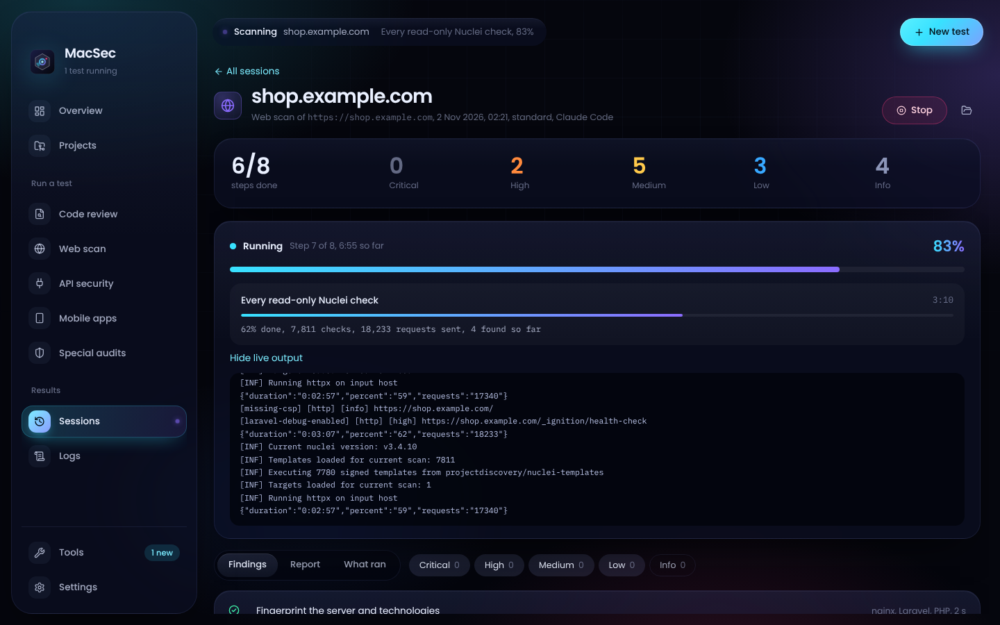

<p align="center"></p>

<h1 align="center">MacSec</h1>

<p align="center">A free security engine for macOS. Deep code review, read-only web and API scans, and an AI reviewer that checks the results, with every test kept as a session you can come back to.</p>

<p align="center"></p>

<p align="center"></p>

## What it does

- **Projects from everywhere.** Your www folder (shared with [Laramac](https://github.com/Pino10/laramac)), every GitHub repository your account can read, and every project and repository in your Azure DevOps organization. Or any folder on your Mac.
- **Deep code review.** MacSec works out the languages and runs the scanners that fit:
  - **Semgrep** with up to 20 rule sets (OWASP Top 10, CWE Top 25, per-language packs, injection, XSS, JWT, insecure transport) plus your own rules
  - **Bearer** for where sensitive data flows
  - **Bandit** (Python) and **gosec** (Go)
  - **zizmor** for GitHub Actions workflows and **Hadolint** for Dockerfiles
  - **Checkov** for infrastructure as code, **Syft** for the SBOM and licences, **Grype** (Deep) as a second opinion on packages
  - **Gitleaks** and **TruffleHog** for keys and passwords, in files and (Deep) the whole Git history
  - **OSV-Scanner** and **Trivy** for known flaws in packages, and risky Docker, Kubernetes and Terraform settings
- **Web scan.** Fingerprints a site, checks its security headers, cookies and HTTPS, can discover the pages nothing links to with **ffuf** (optional, signed out, 20 requests a second, every hit proved again) name the firewall with **wafw00f**, and tells a WAF honeypot from a real finding: all ports open, random paths that answer with the same page, decoy .env and .sql files and slow tarpits become one explained note, not noise in your report, maps its pages with Katana (with **jsluice** reading the endpoints out of the JavaScript), looks for files that should never be public (`.env`, `.git`, backups, phpinfo, logs), and runs every read-only Nuclei check. Quick, Standard and Thorough modes. Optional **control confirmations** prove problems are real with harmless markers: hidden pages and parameters, web firewall tests, login checks and a two-account access check. Signs in through a private MacSec window (or a pasted cookie) to scan behind your login, and checks that private pages really need it. Also checks the certificate and TLS versions, and looks for keys left in the site's public JavaScript.
- **API security.** Load a Postman collection, OpenAPI or Swagger file, from disk or from an address a scan found, or a HAR recording. MacSec reviews what the file says (endpoints with no sign-in, secrets in addresses, real keys saved in examples or the collection, plain HTTP), then makes ordinary GET requests signed in as you to see what comes back: open cross-origin access, sensitive fields, error pages that reveal internals, missing headers.
- **This Mac.** A check-up of your own Mac's security settings, login items, open ports, SSH keys and browser extensions, plus Trivy scans of your Docker images.
- **Updates that answer.** The update check tries the GitHub API, then the releases feed, then github.com itself, and says why if all three fail. Nothing is installed without a click.
- **Recon to scan.** A finished recon hands its first live host and every page it found to a web scan, in one click, so the two halves of a test share the same map.
- **Over time and everywhere.** Each session shows what is new or fixed since the last one; export SARIF, DefectDojo or CycloneDX; MCP for AI tools, a macsec command, Raycast, Shortcuts and Slack, Teams or Discord messages.
- **Recon.** Read-only mapping of a domain: subdomains (certificate logs, CertSpotter, AlienVault OTX, HackerTarget, urlscan.io, Anubis, **subfinder**, **gau**), Wayback and Common Crawl URLs, DNS and takeover hints, live hosts and technologies, archived URLs and parameters, JavaScript source maps, endpoints and keys, and exposed files, with an AI attack surface report.
- **Mobile apps.** Android and iOS apps from source or a built `.apk` or `.ipa`: **mobsfscan**'s MobSF rules, the Android manifest (decoded with **Androguard** for a built app: debuggable, backups, plain HTTP, parts other apps can open), Info.plist (App Transport Security, file sharing, URL schemes), how the compiled code is hardened (PIE, stack canaries, NX, RELRO, ARC, App Store encryption) and keys left inside. MacSec reads the app; it never runs it. For an Android `.apk` you can also run it on a test phone: servers and plain HTTP, certificate pinning, root checks, and secrets in the log or the app's files, each with repeatable proof.
- **Controlled proofs.** When a scan says "possible", this page proves it. Under a written engagement (client, authority reference, the hosts it covers, a window, and caps for requests and writes) it proves impact one step at a time and stops at the first result: **confidentiality** (read a system file through a parameter), **integrity** (template arithmetic, or write one file and read it back), and **availability** (time one request against three, never a flood). A fifth proof sends any request you paste and looks for the string you name. A sixth runs one approved Metasploit module with a command that calls back to this Mac: the callback is the proof that code execution is real. It runs only on a staging target the engagement covers, opens no session and leaves no handler. Two rungs make it a ladder: content discovery under the engagement, and an anonymous read that proves a private page opens with no cookie. Planning chains them, so a write step runs only after the read it depends on is proven, and the run stops at the first proof of each goal. Every step shows the exact requests before you approve it, you type `EXPLOIT <host>` to start, every request is logged with the values hidden, and every write is removed again or listed with where it is. Planning is free: it uses your existing findings, with an optional single AI call that can only pick from the catalogue.
- **Special audits.** A full audit (code review and web scan of the same project, with one AI report that connects them), a portfolio sweep of every project for keys and vulnerable packages, a change review with Claude Code's own `/security-review`, a **mobile app** check, a **cloud account** audit (Azure or AWS: **ScoutSuite** against best practice, **CloudFox** for what the account exposes, **PMapper** for AWS users and roles that could raise their own access), and a **server and ports** check (**naabu** for open ports, **Nmap** for the service on each when you have it, and which ones should not be reachable).
- **WordPress.** Web scans of WordPress sites add **WPScan** (when installed) for the version, plugins and themes, and their known problems. Passive detection only: no password guessing and no user lists.
- **Watch it work.** Every running test shows the step it is on, a clock, a progress bar (with the real percentage when the tool reports one), the tool's latest line in plain words, and a live output panel.
- **Evidence for everything.** Every finding shows the exact lines of code behind it, numbered, with the problem line lit up. Secrets are masked after their first four characters.
- **An AI reviewer.** Claude Code (with your account, on your own LM Studio model, or through Free LLM API and your free keys), Codex, Gemini CLI or your own model reads the code, marks each scanner finding as real or a false alarm, and hunts for what scanners cannot see: missing authorization, IDOR, business logic flaws, unsafe flows across files.
- **Claude Code, your way.** Reviews run as normal Claude Code sessions with your own sign-in (no API key needed, or add one if you prefer), with MacSec's security skills loaded for that session only. **Fix with Claude Code** resumes the exact conversation. Add your own skills to `~/MacSec/extensions/claude/skills`.
- **Sessions.** Every review is kept with its findings, the AI's write-up and each scanner's raw output. Export it as a PDF, or **Continue in Claude Code** to fix the findings (with Remote Control on, so you can carry on at claude.ai/code or on your phone).
- **Tools stay current.** MacSec checks once a day for newer versions of every scanner and updates them with one button, checked against their published checksums. Nuclei's checks and Trivy's database refresh on their own.
- **Tools you open yourself.** radare2 and Ghidra are listed for reading compiled apps by hand. The attack tools from the T3MP3ST pack (Metasploit, sqlmap, Hydra, Frida, objection, drozer, Pacu and others) are listed on Tools with their official sites, marked as not installed: MacSec never installs, runs or controls them. Metasploit is the one exception: an optional switch on the server scan where you approve each module, and only look-only scanners and scanner-module checks exist there, never an exploit module (several of those run code during their check). Real exploitation lives on the Controlled proofs page, behind an engagement, a typed phrase, caps and a cleanup.
- **Your apps.** It finds Claude Code (command line and desktop app), Codex, LM Studio and Burp Suite Professional wherever they are installed, and opens Burp for hands-on testing.
- **One folder, nothing scattered.** Everything lives in `~/MacSec`. Scanners run with a private home folder inside it, so their caches, databases and templates never land in `~/.config`, `~/Library/Caches` or anywhere else.

## Install

Download the DMG for your Mac (Apple Silicon or Intel) from [Releases](https://github.com/Pino10/macsec/releases), open it and drag MacSec to Applications. The first time, macOS says it cannot verify the developer: open **System Settings › Privacy & Security** and click **Open Anyway**.

Then open **Tools** and press **Install missing**. Each scanner is downloaded from its official GitHub release and checked against the checksum its authors publish. Apps with a Homebrew formula (Nmap, WPScan, radare2, Ghidra, the Google Cloud CLI) install with one click on their own row, and only when you press it.

## Depths

| | Quick | Standard | Deep |
| --- | --- | --- | --- |
| Semgrep | core rules | + language packs and focused sets | + full security audit |
| Bearer | | ✓ | ✓ |
| Bandit, gosec | when the language is there | ✓ | ✓ |
| zizmor, Hadolint | when there are workflows or Dockerfiles | ✓ | ✓ |
| Gitleaks | files | files | files and Git history |
| TruffleHog | | files | files and Git history |
| OSV-Scanner | ✓ | ✓ | ✓ |
| Trivy | | ✓ | ✓ |
| AI reviewer | the most exposed code | the project | every entry point, followed through |

Web scans can also run business logic checks (open redirects, forwarded host trust, endless wrong codes, with leads for prices and skipped steps), and every result shows what to fix first and how problems connect. The Assets page gives each site, API and app a risk score over time. Findings that add up are shown as an **attack path**: how it would go, what it reaches, and the one fix that breaks it, in a tab of its own and on Assets. Findings can be re-tested one at a time and copied as tickets. The Tools page has a self-test that proves the checks find planted weaknesses and stay silent on a correct site.

The AI reviewer works through 48 security skills, including attack chains, API authorization, JavaScript analysis and privilege escalation: a review plan, then API security, sign-in and sessions, injection, browser-side issues, business logic, Docker and CI, supply chain, personal data, Supabase and Firebase rules, AI features and Electron apps, as they apply.

## Privacy and safety

- Releases are signed with a key that lives only in the release workflow, and the app refuses an unsigned update.
- Your projects are read in place and never changed. Repositories are cloned into the session's own folder and **deleted when the review ends** unless you choose to keep them.
- Tokens (GitHub, Azure DevOps) are stored with the macOS Keychain and only ever sent to the service they belong to. They are hidden from the logs.
- TruffleHog runs without verification, so keys it finds are never sent to their providers.
- Scanners run with telemetry off, and they never receive your session cookie: a signed-in crawl is MacSec's own, and its requests connect to the address the guard approved, not a fresh DNS answer.
- Claude Code and Codex run read-only (Claude Code in plan mode with only Read, Grep and Glob; Codex in its read-only sandbox), and Claude Code's review session is not saved.

- Mobile checks read the app, including its compiled code and signing, without running it. The optional online check asks once, read only, about the Firebase, S3 and Google Storage addresses inside it. Every web and API scan also saves a test plan built from your checklist, reads the site's JavaScript (hidden chunks, source maps, routes), checks the firewall, DNS and DevOps tools around it, and counts known flaws for the versions it finds from NVD, CISA and EPSS. Findings are labelled Proven, Known exploited, Likely or Not proven.  The optional live phone test (Android `.apk` only) runs the app on an emulator or a phone you confirm, only watches it with Frida (no taps, no typing, no bypass scripts), never saves a secret's value, and removes the app again if MacSec installed it. A built app is unpacked inside its session (with macOS's own tar, which refuses paths that escape the folder) and deleted when the check ends.
- Cloud audits only read. The Azure sign-in stays inside `~/MacSec`; AWS reads your existing profile without changing it. Server checks only open plain connections, and Nmap is never run with its scripts.
- Web and API scans only read, and Nuclei's intrusive, fuzzing and denial-of-service checks are always left out. Control confirmations are the one exception: off until you turn them on for a scan, they send only harmless markers, never change data, never guess passwords at scale, stay on the one site, stop if the server struggles, and report nothing they could not repeat. Anything not on your Mac needs your confirmation that you own it or may test it. For hands-on testing, use Burp Suite.

Use MacSec only on code and systems you own or are allowed to test.

## The MacSec folder

```
~/MacSec
  tools/        every scanner, its databases and caches (tools/home is their private home)
  sessions/     one folder per review: session.json, findings.json, ai-report.md, raw/, the PDF
  extensions/   your own Semgrep rules, Nuclei templates, word lists and AI skills
  logs/         what MacSec did
  config/       settings, and Keychain-encrypted tokens
```

Drop Semgrep rules (`.yml`) into `extensions/semgrep-rules` and they run in every review.

## Release notes

Every release is documented in full in [RELEASE_NOTES.md](RELEASE_NOTES.md): what changed, how it
works, and what is deliberately missing. The Updates page shows the same notes inside the app.
Since 1.14 the product grew from a scanner workbench into something that can prove impact, gate a
build and explain an attack path, so the history is worth reading in order.

| Version | What it added | Notes |
| --- | --- | --- |
| 1.33.0 | Mobile coverage: task hijacking, pinning, resilience, WebView, Keychain classes, MASVS map | [1.33.0](RELEASE_NOTES.md#1330) |
| 1.32.0 | iOS signed entitlements, ad hoc signing, bundle hosts and keys; Android bundle pass | [1.32.0](RELEASE_NOTES.md#1320) |
| 1.31.0 | Patch generation in a scratch copy, with tests, typed apply and rollback | [1.31.0](RELEASE_NOTES.md#1310) |
| 1.30.0 | Amass evaluated and refused, Xcode selected (licence needs accepting) | [1.30.0](RELEASE_NOTES.md#1300) |
| 1.29.0 | Joern measured on the Java pair (1.0/1.0), not yet the whole corpus | [1.29.0](RELEASE_NOTES.md#1290) |
| 1.28.0 | A real MIT APK fixture and the zip, manifest and dex decode path tested | [1.28.0](RELEASE_NOTES.md#1280) |
| 1.27.1 | Fixes the Results crash (React hook order) | [1.27.1](RELEASE_NOTES.md#1271) |
| 1.27.0 | Modern interface pass, window controls aligned, bounded virtual-host discovery | [1.27.0](RELEASE_NOTES.md#1270) |
| 1.26.1 | Bearer, Psalm and PHPStan measured on the corpus; Psalm's JSON shape fixed | [1.26.1](RELEASE_NOTES.md#1261) |
| 1.26.0 | A 33-case SQL corpus across eight languages, the holdout split, and the measured gaps | [1.26.0](RELEASE_NOTES.md#1260) |
| 1.25.1 | The labelled SQL corpus, the holdout split, and the first measured numbers | [1.25.1](RELEASE_NOTES.md#1251) |
| 1.25.0 | The install and cross-engine harnesses, and a weekly check that every install address still works | [1.25.0](RELEASE_NOTES.md#1250) |
| 1.24.1 | Every release page now carries its notes; the tag workflow sets them | [1.24.1](RELEASE_NOTES.md#1241) |
| 1.24.0 | PHP taint analysis, the independent AI verifier, the attack-surface graph, Burp import | [1.24.0](RELEASE_NOTES.md#1240) |
| 1.23.0 | Saved profiles, bulk triage with an owner and a due date, CSV export, the cost estimate on the result | [1.23.0](RELEASE_NOTES.md#1230) |
| 1.22.0 | Web scan and code review rearranged around the decision, pace control, request and cost estimates, Start a test, Cmd+K | [1.22.0](RELEASE_NOTES.md#1220) |
| 1.21.0 | The full release history, a SQLite session index, interface cleanup | [1.21.0](RELEASE_NOTES.md#1210) |
| 1.20.0 | A command line with baselines, search across sessions, storage cleanup, an accuracy gate in CI, accessibility | [1.20.0](RELEASE_NOTES.md#1200) |
| 1.19.0 | The five trust fixes: no credentials to tools, pinned DNS, masked evidence, signed releases, reviewer scope. Proofs reach findings | [1.19.0](RELEASE_NOTES.md#1190) |
| 1.18.0 | Attack paths with the one fix that breaks them, four more skills, jsluice through Katana, a rebuilt Assets page | [1.18.0](RELEASE_NOTES.md#1180) |
| 1.17.0 | WAF honeypots and deception, Metasploit runs proved by a callback, API sign-in mismatches, JavaScript delta | [1.17.0](RELEASE_NOTES.md#1170) |
| 1.16.0 | gau, wafw00f and sqlmap with bounds, recon to scan handover, Homebrew installs, API specs from an address | [1.16.0](RELEASE_NOTES.md#1160) |
| 1.15.0 | ffuf as a discovery engine, the read to write ladder, editable plan steps | [1.15.0](RELEASE_NOTES.md#1150) |
| 1.14.0 | Controlled proofs under a written engagement, CIA by design, chaining, the Metasploit check list fixed | [1.14.0](RELEASE_NOTES.md#1140) |

Earlier versions, back to 0.1, are in the same file. The work planned for 1.24 is in [ROADMAP.md](ROADMAP.md).

## From the command line

CI can gate a build without opening the app:

```sh
MacSec --headless scan --path ~/Laramac/www/shop --depth standard --fail-on high
MacSec --headless baseline --path ~/Laramac/www/shop   # writes .macsec-baseline.json, commit it
MacSec --headless bench                                  # the accuracy of the built-in checks
```

Exit codes: 0 clean or only known findings, 1 a new finding reached the threshold, 2 an error, 3 scanners missing (install them in the app, or add `--install-missing`). `--json` prints the result for a pipeline, and `--baseline <file>` / `--no-baseline` choose what counts as known.

## Development

```sh
npm install
npm run dev        # the app, with live reload
npm test           # tests (the end-to-end test runs when Semgrep and Bandit are in /tmp/scanvenv)
npm run typecheck
npm run dist       # a DMG in dist/
```

See [MAINTAINING.md](MAINTAINING.md) for releases and how things fit together.

## License

MIT. Each scanner keeps its own license; MacSec downloads them, it does not include them.
