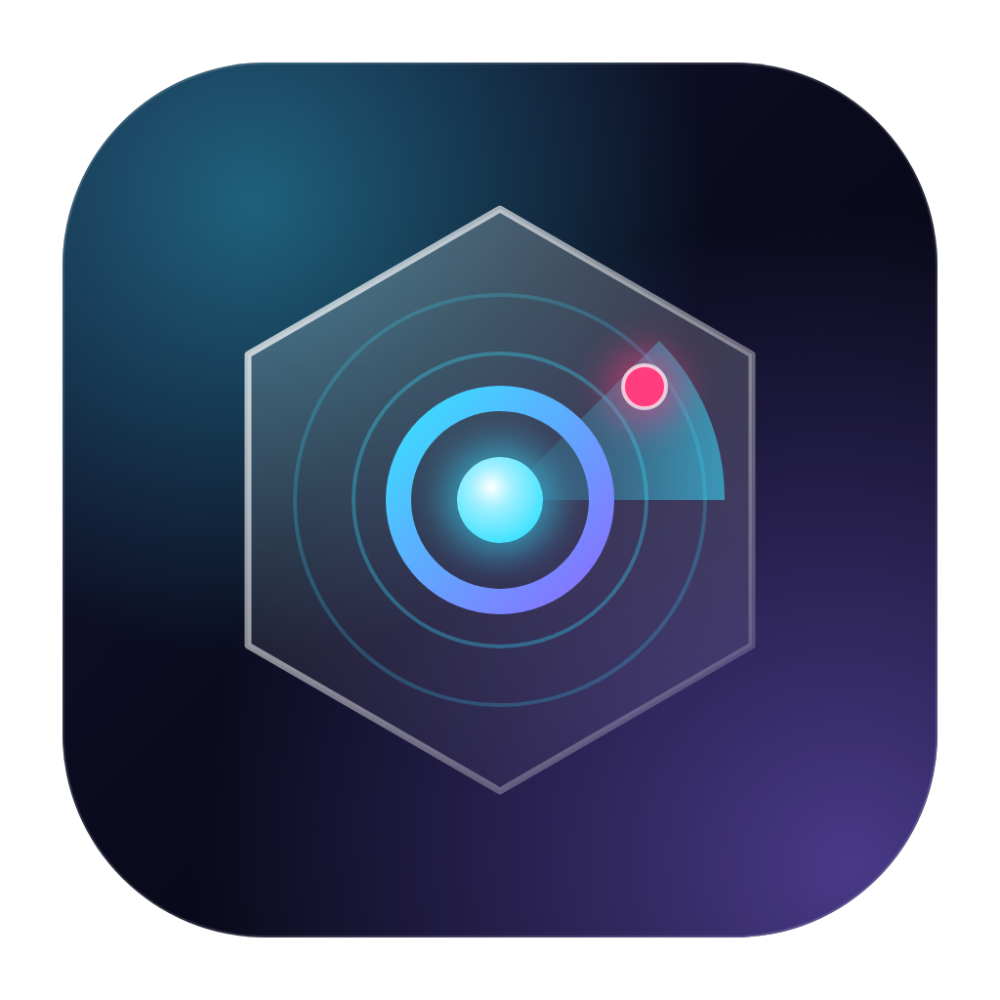
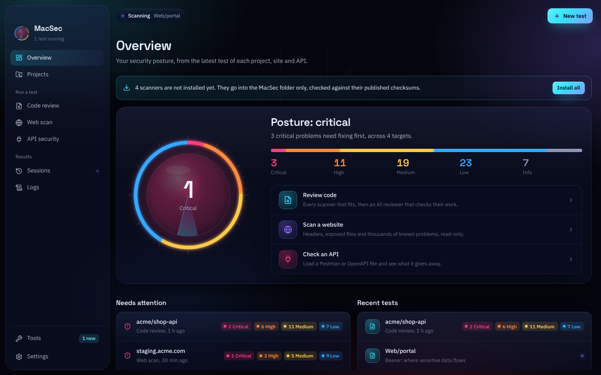
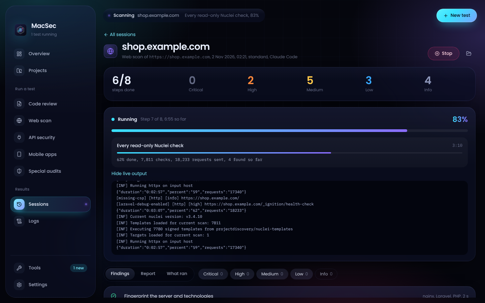

<p align="center"></p>

<h1 align="center">MacSec</h1>

<p align="center">A free security engine for macOS. Deep code review, read-only web and API scans, and an AI reviewer that checks the results, with every test kept as a session you can come back to.</p>

<p align="center"></p>

<p align="center"></p>

## What it does

- **Projects from everywhere.** Your www folder (shared with [Laramac](https://github.com/Pino10/laramac)), every GitHub repository your account can read, and every project and repository in your Azure DevOps organization. Or any folder on your Mac.
- **Deep code review.** MacSec works out the languages and runs the scanners that fit:
  - **Semgrep** with up to 20 rule sets (OWASP Top 10, CWE Top 25, per-language packs, injection, XSS, JWT, insecure transport) plus your own rules
  - **Bearer** for where sensitive data flows
  - **Bandit** (Python) and **gosec** (Go)
  - **Gitleaks** and **TruffleHog** for keys and passwords, in files and (Deep) the whole Git history
  - **OSV-Scanner** and **Trivy** for known flaws in packages, and risky Docker, Kubernetes and Terraform settings
- **Web scan.** Fingerprints a site, checks its security headers, cookies and HTTPS, maps its pages with Katana, looks for files that should never be public (`.env`, `.git`, backups, phpinfo, logs), and runs every read-only Nuclei check. Quick, Standard and Thorough modes. Signs in through a private MacSec window (or a pasted cookie) to scan behind your login, and checks that private pages really need it. Also checks the certificate and TLS versions, and looks for keys left in the site's public JavaScript.
- **API security.** Load a Postman collection, OpenAPI or Swagger file, or a HAR recording. MacSec reviews what the file says (endpoints with no sign-in, secrets in addresses, real keys saved in examples or the collection, plain HTTP), then makes ordinary GET requests signed in as you to see what comes back: open cross-origin access, sensitive fields, error pages that reveal internals, missing headers.
- **Mobile apps.** Android and iOS apps from source or a built `.apk` or `.ipa`: **mobsfscan**'s MobSF rules, the Android manifest (decoded with **Androguard** for a built app: debuggable, backups, plain HTTP, parts other apps can open), Info.plist (App Transport Security, file sharing, URL schemes), how the compiled code is hardened (PIE, stack canaries, NX, RELRO, ARC, App Store encryption) and keys left inside. MacSec reads the app; it never runs it.
- **Special audits.** A full audit (code review and web scan of the same project, with one AI report that connects them), a portfolio sweep of every project for keys and vulnerable packages, a change review with Claude Code's own `/security-review`, a **mobile app** check, a **cloud account** audit (Azure or AWS: **ScoutSuite** against best practice, **CloudFox** for what the account exposes, **PMapper** for AWS users and roles that could raise their own access), and a **server and ports** check (**naabu** for open ports, **Nmap** for the service on each when you have it, and which ones should not be reachable).
- **WordPress.** Web scans of WordPress sites add **WPScan** (when installed) for the version, plugins and themes, and their known problems. Passive detection only: no password guessing and no user lists.
- **Watch it work.** Every running test shows the step it is on, a clock, a progress bar (with the real percentage when the tool reports one), the tool's latest line in plain words, and a live output panel.
- **Evidence for everything.** Every finding shows the exact lines of code behind it, numbered, with the problem line lit up. Secrets are masked after their first four characters.
- **An AI reviewer.** Claude Code, Codex or your own model in LM Studio reads the code, marks each scanner finding as real or a false alarm, and hunts for what scanners cannot see: missing authorization, IDOR, business logic flaws, unsafe flows across files.
- **Claude Code, your way.** Reviews run as normal Claude Code sessions with your own sign-in (no API key needed, or add one if you prefer), with MacSec's security skills loaded for that session only. **Fix with Claude Code** resumes the exact conversation. Add your own skills to `~/MacSec/extensions/claude/skills`.
- **Sessions.** Every review is kept with its findings, the AI's write-up and each scanner's raw output. Export it as a PDF, or **Continue in Claude Code** to fix the findings (with Remote Control on, so you can carry on at claude.ai/code or on your phone).
- **Tools stay current.** MacSec checks once a day for newer versions of every scanner and updates them with one button, checked against their published checksums. Nuclei's checks and Trivy's database refresh on their own.
- **Tools you open yourself.** radare2 and Ghidra are listed for reading compiled apps by hand. The attack tools from the T3MP3ST pack (Metasploit, sqlmap, Hydra, Frida, objection, drozer, Pacu and others) are listed on Tools with their official sites, marked as not installed: MacSec never installs, runs or controls them.
- **Your apps.** It finds Claude Code (command line and desktop app), Codex, LM Studio and Burp Suite Professional wherever they are installed, and opens Burp for hands-on testing.
- **One folder, nothing scattered.** Everything lives in `~/MacSec`. Scanners run with a private home folder inside it, so their caches, databases and templates never land in `~/.config`, `~/Library/Caches` or anywhere else.

## Install

Download the DMG for your Mac (Apple Silicon or Intel) from [Releases](https://github.com/Pino10/macsec/releases), open it and drag MacSec to Applications. The first time, macOS says it cannot verify the developer: open **System Settings › Privacy & Security** and click **Open Anyway**.

Then open **Tools** and press **Install missing**. Each scanner is downloaded from its official GitHub release and checked against the checksum its authors publish.

## Depths

| | Quick | Standard | Deep |
| --- | --- | --- | --- |
| Semgrep | core rules | + language packs and focused sets | + full security audit |
| Bearer | | ✓ | ✓ |
| Bandit, gosec | when the language is there | ✓ | ✓ |
| Gitleaks | files | files | files and Git history |
| TruffleHog | | files | files and Git history |
| OSV-Scanner | ✓ | ✓ | ✓ |
| Trivy | | ✓ | ✓ |
| AI reviewer | the most exposed code | the project | every entry point, followed through |

## Privacy and safety

- Your projects are read in place and never changed. Repositories are cloned into the session's own folder and **deleted when the review ends** unless you choose to keep them.
- Tokens (GitHub, Azure DevOps) are stored with the macOS Keychain and only ever sent to the service they belong to. They are hidden from the logs.
- TruffleHog runs without verification, so keys it finds are never sent to their providers.
- Scanners run with telemetry off.
- Claude Code and Codex run read-only (Claude Code in plan mode with only Read, Grep and Glob; Codex in its read-only sandbox), and Claude Code's review session is not saved.

- Mobile checks read the app. A built app is unpacked inside its session (with macOS's own tar, which refuses paths that escape the folder) and deleted when the check ends.
- Cloud audits only read. The Azure sign-in stays inside `~/MacSec`; AWS reads your existing profile without changing it. Server checks only open plain connections, and Nmap is never run with its scripts.
- Web and API scans only read. Nothing is fuzzed, brute-forced, exploited or changed; Nuclei's intrusive, fuzzing and denial-of-service checks are always left out, and requests are slow. Anything not on your Mac needs your confirmation that you own it or may test it. For hands-on testing, use Burp Suite.

Use MacSec only on code and systems you own or are allowed to test.

## The MacSec folder

```
~/MacSec
  tools/        every scanner, its databases and caches (tools/home is their private home)
  sessions/     one folder per review: session.json, findings.json, ai-report.md, raw/, the PDF
  extensions/   your own Semgrep rules, Nuclei templates and AI skills
  logs/         what MacSec did
  config/       settings, and Keychain-encrypted tokens
```

Drop Semgrep rules (`.yml`) into `extensions/semgrep-rules` and they run in every review.

## Development

```sh
npm install
npm run dev        # the app, with live reload
npm test           # tests (the end-to-end test runs when Semgrep and Bandit are in /tmp/scanvenv)
npm run typecheck
npm run dist       # a DMG in dist/
```

See [MAINTAINING.md](MAINTAINING.md) for releases and how things fit together.

## License

MIT. Each scanner keeps its own license; MacSec downloads them, it does not include them.
