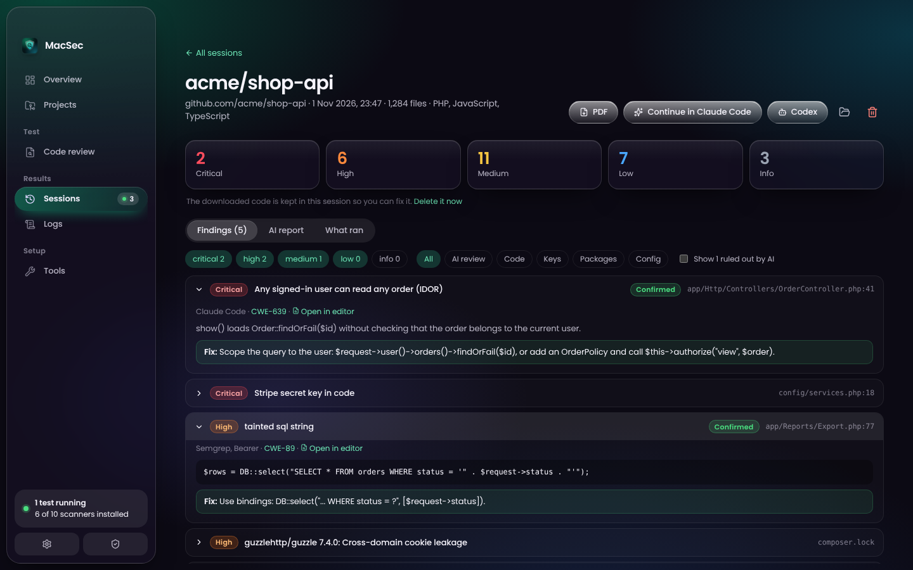

<p align="center"></p>

<h1 align="center">MacSec</h1>

<p align="center">A free security workbench for macOS. Deep code review with every free scanner that fits your code, an AI reviewer that checks their work, and a report you can come back to.</p>

<p align="center"></p>

## What it does

- **Projects from everywhere.** Your www folder (shared with [Laramac](https://github.com/Pino10/laramac)), every GitHub repository your account can read, and every project and repository in your Azure DevOps organization. Or any folder on your Mac.
- **Deep code review.** MacSec works out the languages and runs the scanners that fit:
  - **Semgrep** with up to 20 rule sets (OWASP Top 10, CWE Top 25, per-language packs, injection, XSS, JWT, insecure transport) plus your own rules
  - **Bearer** for where sensitive data flows
  - **Bandit** (Python) and **gosec** (Go)
  - **Gitleaks** and **TruffleHog** for keys and passwords, in files and (Deep) the whole Git history
  - **OSV-Scanner** and **Trivy** for known flaws in packages, and risky Docker, Kubernetes and Terraform settings
- **An AI reviewer.** Claude Code, Codex or your own model in LM Studio reads the code, marks each scanner finding as real or a false alarm, and hunts for what scanners cannot see: missing authorization, IDOR, business logic flaws, unsafe flows across files.
- **Sessions.** Every review is kept with its findings, the AI's write-up and each scanner's raw output. Export it as a PDF, or **Continue in Claude Code** to fix the findings (with Remote Control on, so you can carry on at claude.ai/code or on your phone).
- **One folder, nothing scattered.** Everything lives in `~/MacSec`. Scanners run with a private home folder inside it, so their caches, databases and templates never land in `~/.config`, `~/Library/Caches` or anywhere else.

## Install

Download the DMG for your Mac (Apple Silicon or Intel) from [Releases](https://github.com/Pino10/macsec/releases), open it and drag MacSec to Applications. The first time, macOS says it cannot verify the developer: open **System Settings › Privacy & Security** and click **Open Anyway**.

Then open **Tools** and press **Install missing**. Each scanner is downloaded from its official GitHub release and checked against the checksum its authors publish.

## Depths

| | Quick | Standard | Deep |
| --- | --- | --- | --- |
| Semgrep | core rules | + language packs and focused sets | + full security audit |
| Bearer | | ✓ | ✓ |
| Bandit, gosec | when the language is there | ✓ | ✓ |
| Gitleaks | files | files | files and Git history |
| TruffleHog | | files | files and Git history |
| OSV-Scanner | ✓ | ✓ | ✓ |
| Trivy | | ✓ | ✓ |
| AI reviewer | the most exposed code | the project | every entry point, followed through |

## Privacy and safety

- Your projects are read in place and never changed. Repositories are cloned into the session's own folder and **deleted when the review ends** unless you choose to keep them.
- Tokens (GitHub, Azure DevOps) are stored with the macOS Keychain and only ever sent to the service they belong to. They are hidden from the logs.
- TruffleHog runs without verification, so keys it finds are never sent to their providers.
- Scanners run with telemetry off.
- Claude Code and Codex run read-only (Claude Code in plan mode with only Read, Grep and Glob; Codex in its read-only sandbox), and Claude Code's review session is not saved.

Use MacSec only on code and systems you own or are allowed to test.

## The MacSec folder

```
~/MacSec
  tools/        every scanner, its databases and caches (tools/home is their private home)
  sessions/     one folder per review: session.json, findings.json, ai-report.md, raw/, the PDF
  extensions/   your own Semgrep rules, Nuclei templates and AI skills
  logs/         what MacSec did
  config/       settings, and Keychain-encrypted tokens
```

Drop Semgrep rules (`.yml`) into `extensions/semgrep-rules` and they run in every review.

## Development

```sh
npm install
npm run dev        # the app, with live reload
npm test           # tests (the end-to-end test runs when Semgrep and Bandit are in /tmp/scanvenv)
npm run typecheck
npm run dist       # a DMG in dist/
```

See [MAINTAINING.md](MAINTAINING.md) for releases and how things fit together.

## License

MIT. Each scanner keeps its own license; MacSec downloads them, it does not include them.
